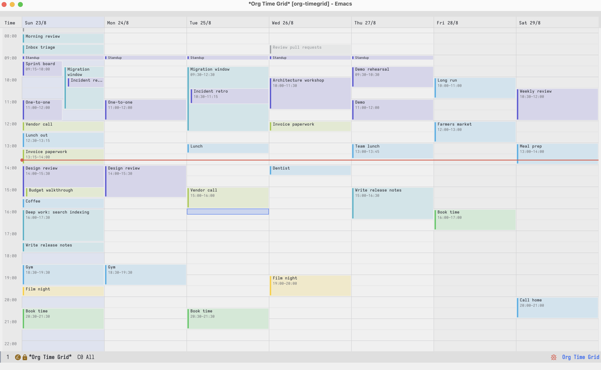
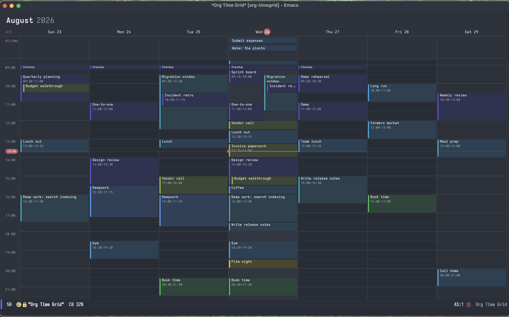
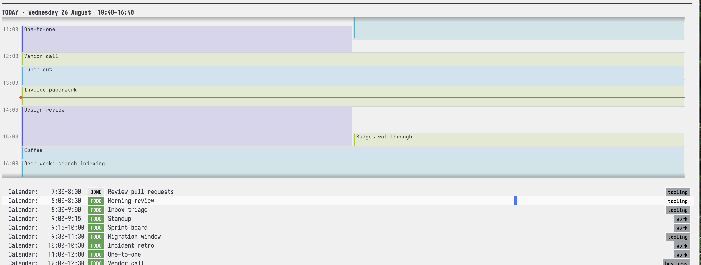
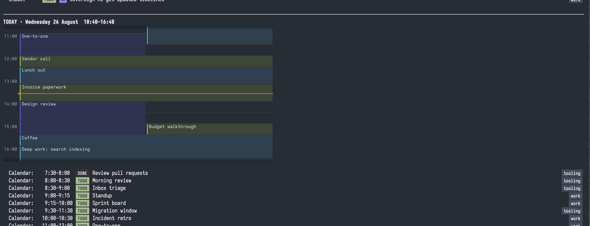

# org-timegrid

[](https://melpa.org/#/org-timegrid)
[](#ai-usage)

`org-timegrid` is an SVG calendar for Org mode. It reads active timestamps
and clock records from your Org files and writes edits back to their source headings.

Create, move, resize, copy, rename, and remove calendar blocks with the mouse
or keyboard. The same renderer can add a compact, read-only day view to an
existing Org Agenda.


https://github.com/user-attachments/assets/58205a76-1895-4a91-83ed-4adc69ca6920


## Screenshots

The palette comes from the theme, and is redrawn when the theme changes.

|  |  |
| --- | --- |
|  |  |

Agenda view:

|  |  |
| --- | --- |
|  |  |

## Requirements and installation

You need Emacs 29.1 or later with SVG support and Org 9.6 or later. Check SVG
support with `(image-type-available-p 'svg)`. There are no other dependencies.

`org-timegrid` is available on [MELPA](https://melpa.org/#/org-timegrid).
With MELPA configured, run `M-x package-refresh-contents`, then
`M-x package-install RET org-timegrid RET`, or use `use-package`:

```elisp
(use-package org-timegrid
  :ensure t
  :commands (org-timegrid-week)
  :bind ("C-c c" . org-timegrid-week))
```

To install directly from GitHub with [Elpaca](https://github.com/progfolio/elpaca):

```elisp
(use-package org-timegrid
  :ensure (:host github :repo "Gleek/org-timegrid")
  :commands (org-timegrid-week)
  :bind ("C-c c" . org-timegrid-week))
```

For a manual install, put the `.el` files on `load-path`, evaluate `(require
'org-timegrid-org)`, then run `M-x org-timegrid-week`.

### Complete example configuration

This reads `org-agenda-files`, saves new entries in `~/org/calendar.org`,
and adds the optional Agenda strip.

```elisp
(use-package org-timegrid
  :ensure t
  :bind ("C-c a c" . org-timegrid-week)
  :init
  (setq org-timegrid-org-capture-file "~/org/calendar.org"
        org-timegrid-org-tag-color-alist
        '(("work" . indigo) ("personal" . green)))
  :config
  (require 'org-timegrid-org))

(use-package org-timegrid-agenda
  :ensure nil
  :after org-agenda
  :config
  (org-timegrid-agenda-mode 1))
```

The capture file is always included in calendar queries.

### Android Emacs

See [`ANDROID.org`](ANDROID.org) for setup. Android uses a one-day view,
native scrolling, and long-press editing. Set
`org-timegrid-android-display-keyboard` to non-nil to enable the on-screen keyboard.
Resize handles and a short vibration provide feedback during touch editing.

https://github.com/user-attachments/assets/fc368b76-4b29-40d0-8a0a-536ac526f6e0

## What appears on the calendar

The Org backend reads active timestamps with a start time. They may be plain
timestamps or values attached to `SCHEDULED` and `DEADLINE`.

```org
* TODO Design review :work:
<2026-08-24 Mon 14:00-15:30>

* TODO Standup
SCHEDULED: <2026-08-24 Mon 09:00-09:15>

* Call the vendor
<2026-08-24 Mon 15:00>
```

A TODO keyword is optional. Timestamps without an end use
`org-timegrid-default-duration-minutes` (30 minutes).
Date-only entries appear in the all-day rail.

Org clocks appear along the day's right boundary. Finished clocks can be
edited; stop running clocks first. Other inactive timestamps are hidden.

### Repeaters

Repeating events appear by default. `org-timegrid` handles them a little
differently from Org, so you can change a recurring schedule as you would
in a typical calendar: adjust one occurrence or future occurrences while
keeping earlier times intact.

When you move, resize, or delete a repeating block, choose:

- **just this**: change only the selected occurrence.
- **this and future**: change this occurrence and the ones that follow it.
- **all**: change every occurrence in the selected series, including earlier ones.

Under a heading with repeaters, each new timestamp starts a new schedule
from its date. The previous schedule stops the day before:

```org
* Daily walk
<2026-10-01 Thu 17:00-17:30 +1d>
<2026-10-06 Tue 18:00-18:30 +1d>
```

The walk is at 5pm through October 5, then at 6pm from October 6 onward.
Changing the later series leaves the earlier 5pm walks intact, even when
you choose **all**. **this and future** also stops at the next schedule
change, if one exists.

This schedule history is specific to `org-timegrid`. Org Agenda treats the
repeaters independently and does not honor these cutoffs. Use separate
headings for unrelated repeating events.

To treat timestamps as independent schedules instead, disable history:

- Globally: `(setq org-timegrid-org-repeater-history nil)`.
- For a file: `#+PROPERTY: TIMEGRID_REPEATER_HISTORY nil`.
- For a heading and its children: set `:TIMEGRID_REPEATER_HISTORY: nil` in
  its property drawer.

The nearest heading setting takes precedence, then the file setting, then
the global setting. Set `org-timegrid-org-show-repeaters` to `nil` to hide
repeating events entirely.

Moves scoped to **just this** or **this and future** must stay on the same
date. Hourly repeaters support **all** only. Deleting occurrences leaves
inactive `CANCELLED:` timestamps in the Org file to record where the schedule
stops or skips a date. As with other calendar edits, changes remain unsaved
by default.

## Week view

Run `M-x org-timegrid-week` to open the week containing today.

### Mouse

| Gesture | Action |
| --- | --- |
| Drag empty space | Create an entry for that range |
| Drag a block | Move it |
| Drag a block's top or bottom edge | Resize it |
| super-drag a block | Duplicate it as an independent entry |
| shift-drag a block | Add another time to its source entry |
| Click | Put the cursor there |
| Double-click a block | Visit its Org heading |
| Wheel | Scroll the day |

Mouse edits snap to `org-timegrid-slot-minutes`, which also sets the minimum
duration (15 minutes by default). Release commits a drag. Press `C-g` before
releasing to cancel it.

Nearby drag and resize positions are prepared between inputs to speed up
previews. Set `org-timegrid-preview-prefetch` to `nil` to disable this extra work.

### Keyboard

Use `C-SPC` and movement to select a region. Without a region, edits apply to
the selected block. Copies use the Emacs kill ring.

| Key | Action |
| --- | --- |
| `C-n` / `C-p`, up/down | Move through times and blocks |
| `C-f` / `C-b`, left/right | Move through overlapping blocks and days |
| `C-v` / `M-v`, `SPC` | Move by one screen |
| `C-a` / `C-e` | Go to the first or last slot of the day |
| `C-l` | Center the view on the cursor |
| `C-x +` / `C-x C--` / `C-x C-0` | Zoom in, out, or reset |
| `n` / `p` | Select the next or previous block |
| `C-SPC`, `C-x C-x` | Set mark, or exchange point and mark |
| `RET` | Visit or create a block |
| `C-g` | Clear the region or hide the cursor |
| `M-down` / `M-up` | Move the selected block by one slot |
| `M-right` / `M-left` | Move the block by one day |
| `S-down` / `S-up` | Move the end time |
| `C-S-up` / `C-S-down` | Move the start time |
| `t` | Enter a new time or range |
| `e` | Rename the heading |
| `d`, backspace | Remove selected blocks |
| `M-w`, then `C-y` | Copy and paste as new entries |
| `C-w`, then `C-y` | Cut and paste |
| `M-w`, then `C-u C-y` | Paste into the original entries |
| `M-y` | Cycle through earlier copies |
| `C-/`, `C-x u` | Undo |
| `:`, `C-c C-q` | Change the selected entry's tags |
| `C-c C-t` | Change the selected entry's TODO state |
| `,`, `C-c ,` | Set the selected entry's priority |
| `i` | Clock in to the selected entry |
| `O` | Clock out |
| `z`, `C-c C-z` | Add a note to the selected entry |
| `C-c C-x e` | Set the selected entry's effort |
| `C-c C-w` | Refile the selected entry |
| `$` | Archive the selected entry |
| `b` / `f`, `M-b` / `M-f` | Shift by a day or week |
| `j` / `.` | Jump to a date or today |
| `g` | Reload the calendar |
| `q` | Quit |
| `C-s`, `C-r` | Search block titles |

Use `org-timegrid-org-command` to bind commands at the selected heading,
or `org-timegrid-org-agenda-command` for commands requiring a live Agenda entry:

```elisp
(keymap-set org-timegrid-mode-map "i"
            (org-timegrid-org-command #'org-clock-in))
(keymap-set org-timegrid-mode-map ","
            (org-timegrid-org-agenda-command #'org-agenda-priority))
```

## Org Agenda strip

Enable the optional integration after loading `org-timegrid-agenda`:

```elisp
(require 'org-timegrid-agenda)
(org-timegrid-agenda-mode 1)
```

The strip shows the hours around now. Press `RET` to open the calendar.

```elisp
(setq org-timegrid-agenda-insert-after "To Refile"
      org-timegrid-agenda-separator nil)
```

`org-timegrid-agenda-insert-after` names the block above the strip.
Set `org-timegrid-agenda-separator` to nil to omit its separator.

### Org date picker

The `j` date picker highlights dates containing events. Set
`org-timegrid-calendar-highlight-dates` to nil to disable this, or customize
`org-timegrid-calendar-event-face` to change its appearance.

## Colours

The grid, text, cursor, and backgrounds use the current Emacs theme. Images
redraw after a theme change and respect buffer-local face remapping.

Map Org tags to the built-in macOS-style palette or any colour string Emacs
accepts:

```elisp
(setq org-timegrid-org-tag-color-alist
      '(("work" . indigo)
        ("business" . lime)
        ("reading" . green)
        ("errand" . cyan)
        ("urgent" . "#b4d74a")))
```

The named colours are `blue`, `cyan`, `teal`, `indigo`, `purple`, `pink`, `red`, `orange`, `yellow`,
`lime`, `green`, `brown`, and `graphite`. The last mapped tag wins, checking file tags, ancestor
tags, then local tags. Set `org-timegrid-org-color-function` to colour by TODO state, priority,
property, or file.

## Configuration

Use `M-x customize-group RET org-timegrid` for the main options.

| Calendar option | Default | Meaning |
| --- | --- | --- |
| `org-timegrid-days` | `7` | Consecutive days shown |
| `org-timegrid-range-alignment` | `week` | Align to week start or center the target date |
| `org-timegrid-start-hour` / `org-timegrid-end-hour` | `0` / `24` | Hours shown |
| `org-timegrid-time-format` | `12h` | `12h` or `24h` labels |
| `org-timegrid-default-zoom` | `0.7` | Initial size; adjust with text-scale commands |
| `org-timegrid-slot-minutes` | `15` | Keyboard step and edit granularity |
| `org-timegrid-default-duration-minutes` | `30` | Duration when no end is given |
| `org-timegrid-default-color` | `blue` | Colour for unmapped events |
| `org-timegrid-all-day-max-lanes` | `5` | Maximum visible all-day rows |

| Org option | Default | Meaning |
| --- | --- | --- |
| `org-timegrid-org-files` | `agenda` | Use Org agenda files, an explicit file list, or a function |
| `org-timegrid-org-capture-file` | `calendar.org` in `user-emacs-directory` | Destination for new entries; always queried |
| `org-timegrid-org-capture-template` | title and time range | Structure and location of new entries |
| `org-timegrid-org-auto-save` | `nil` | Save after calendar edits |
| `org-timegrid-org-show-done` | `t` | Show completed entries |
| `org-timegrid-org-show-clocks` | `t` | Show finished and running clocks |
| `org-timegrid-org-exclude-tags` | `nil` | Tags to hide |
| `org-timegrid-org-tag-color-alist` | `nil` | Tag-to-colour mapping |

| Agenda option | Default | Meaning |
| --- | --- | --- |
| `org-timegrid-agenda-minutes-before` / `org-timegrid-agenda-minutes-after` | `180` / `180` | Window around now |
| `org-timegrid-agenda-insert-after` | `"To Refile"` | Agenda block above the strip; nil places it at the top |
| `org-timegrid-agenda-separator` | `t` | Separator after the strip |

| Android option | Default | Meaning |
| --- | --- | --- |
| `org-timegrid-android-zoom` | `1.5` | Initial size on Android |
| `org-timegrid-android-display-keyboard` | `nil` | Show the on-screen keyboard |
| `org-timegrid-android-haptic-duration` | `60` | Long-press vibration in milliseconds; nil disables it |

Creating a block offers existing headings. Choose one to add a timestamp,
or enter a new title to create a heading in `org-timegrid-org-capture-file`.

The default template is `(:target file :template "* %{title}\n%{time-range}\n%?")`.
Its target may also be `datetree`, `(headline "Name")`, or
`(olp "Parent" "Child")`. Template headings are relative to that target. The
available substitutions are `%{title}`, `%{time-range}`, `%{start}`, `%{end}`,
`%{duration}`, `%<FORMAT>` (using the selected start time), and `%?` for the
final point.

To keep calendar entries in a dedicated file organized by their start date:

```elisp
(setq org-timegrid-org-capture-file "~/org/timegrid.org"
      org-timegrid-org-capture-template
      '(:target datetree
        :template "* %{title}\n%{time-range}\n%?"))
```

## Hooks and custom backends

For Lisp configuration, `org-timegrid-org-filter-function` controls which
events appear, `org-timegrid-org-entry-filter-function` controls the headings
offered when creating a block, and `org-timegrid-org-color-function` controls
heading colours. Use `C-h v` to read their calling conventions.

`org-timegrid-org-after-create-hook` runs with point on a newly created Org
heading. Hook edits join the same undo step.

```elisp
(add-hook 'org-timegrid-org-after-create-hook
          (lambda ()
            (org-set-property
             "CREATED_AT" (format-time-string "[%F %a %R]"))))
```

For other sources, pass a backend to `org-timegrid-open`.
See `org-timegrid-backend-create` for the backend API.

## Related packages

I use these alongside `org-timegrid`:

- [org-wild-notifier](https://github.com/emacsorphanage/org-wild-notifier)
  for desktop reminders before Org events.
- [org-time-analytics](https://github.com/Gleek/org-time-analytics)
  for reports on time allocated through active timestamp ranges, grouped by
  tag, TODO state, category, or property.
- [Orgzly Revived](https://github.com/orgzly-revived/orgzly-android-revived)
  for Org reminders and notifications on Android.
- [org-upcoming-modeline](https://github.com/unhammer/org-upcoming-modeline)
  with the following settings:

  ```elisp
  (setq org-upcoming-modeline-only-show-soon t
        org-upcoming-modeline-show-running t)
  ```

### Calendar synchronization

- [org-gcal](https://github.com/kidd/org-gcal.el) for syncing Org events
  with Google Calendar.
- [org-caldav](https://github.com/dengste/org-caldav) for syncing Org events
  with CalDAV calendars.
- [org-outlook](https://github.com/ifitzpat/org-outlook) for syncing Org events
  with Outlook.

## Development

Run the tests:

```sh
emacs -Q --batch -L . -l test/run-tests.el
```

## Credits and status

The visual design and interaction borrow from macOS Calendar. [`org-timeblock`](https://github.com/ichernyshovvv/org-timeblock)
and [`timeblock`](https://github.com/ichernyshovvv/timeblock.el) supplied the idea of drawing an Emacs calendar with SVG, and
[`calfw`](https://github.com/kiwanami/emacs-calfw) and [`calfw-blocks`](https://github.com/ml729/calfw-blocks) were the original
inspiration toward a calendar view for Org.

## AI usage
Even though I directed the UI, interaction design, package structure, public
commands, and customization options. Opus 5 and GPT-5.6-Codex wrote all code
in the current implementation. The SVG renderer was agent-written and then
reworked through hands-on usability testing.
