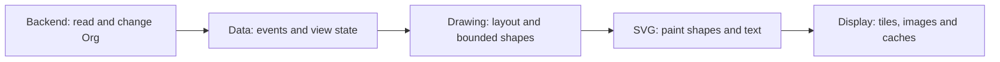

# Rendering architecture

org-timegrid gets responsiveness by reusing SVG drawings and replacing small
images. This guide follows that rendering path; usage is in the
[README](../README.md).

## The boundaries



| Part    | Owns                                                   | Why separate?                                                         |
|---------|--------------------------------------------------------|-----------------------------------------------------------------------|
| Backend | Source buffers, parsing, writes and undo.              | Drawing never needs to understand Org syntax.                         |
| Data    | Event values, displayed dates, selection and previews. | One state drives mouse, keyboard and drawing.                         |
| Drawing | Pixel positions and descriptions of what to paint.     | Layout can be calculated without creating images or changing buffers. |
| SVG     | Turning descriptions into SVG markup.                  | Painting has no storage or cache responsibilities.                    |
| Display | Image creation, placement, reuse and release.          | Emacs resource management stays outside layout.                       |

An **event** holds calendar times. A **block** expresses those times relative
to the displayed days. A **scene** contains drawing items with bounds:
`x`, `y`, `width`, `height`, plus appearance information.

For example, Monday's 10:00–11:00 meeting becomes a block with day `0` and
minutes `600–660`. Layout turns it into a rectangle in Monday's column. The
scene describes that rectangle and its label; the SVG code paints them.

A confirmed edit goes through the backend, changes the source and updates the
event data. A preview substitutes temporary blocks in the drawing path. It
never needs to rewrite Org just to show a possible position.

## How SVG becomes tiles

The grid is divided into day columns and roughly hour-high rows, with a separate
column for time labels. Each cell is one **tile**, a complete SVG image.

```text
                 Monday           Tuesday
             ┌────────────────┬────────────────┐
    09–10    │ tile           │ tile           │
             ├────────────────┼────────────────┤
    10–11    │ Team meeting   │ tile           │
             ├────────────────┼────────────────┤
    11–12    │ tile           │ tile           │
             └────────────────┴────────────────┘
              ↑ replace this column's affected tiles
```

These are image boundaries, independent of the 15-minute editing steps. The
sketch omits small insets and rounding at tile edges.

Tile construction has two passes:

1. **Choose drawings by bounds.** A meeting contributes SVG only to tiles its
   rectangle touches. Grid lines and backgrounds also have explicit bounds.
2. **Trim the SVG within each tile.** Separate culling helpers remove content
   outside the tile and crop plain filled rectangles. *Culling* means leaving
   out drawing content that cannot be visible.

Each tile uses an SVG `viewBox`, the rectangle of shared calendar coordinates
that the image shows. Shapes keep their calendar coordinates across tiles.
There is no intermediate full-calendar bitmap to slice up.

In Emacs, each tile replaces a space through that character's `display`
property. Images sit beside one another; newlines separate tile rows. The date
header and all-day area use a separate header-line image, so they stay fixed
while the grid scrolls.

## What gets redrawn

**Static** means reusable until the event data or drawing settings change.
**Transient** means a drawing that changes during interaction or as time passes.

| Reusable drawings                   | Transient drawings                                            |
|-------------------------------------|---------------------------------------------------------------|
| Grid, day shading, committed events | Preview, cursor, selection, marked range, current-time marker |

For each affected tile, composition follows this order:

```text
    Cached grid and committed SVG
                  ↓
    Add preview or selection SVG
                  ↓
    Add current-time marker last
                  ↓
    One complete tile image
```

These are SVG drawing stages, not independent Emacs image layers. Updating a
preview creates or reuses a finished tile image and replaces its display
property.

## Example: extend Monday's meeting to noon

Start with a committed 10:00–11:00 meeting. Follow the first preview, then a
later update from 11:45 to 12:00. Assume its width and styling stay unchanged.
The sketches use hour boundaries for readability; real bounds include pixel
insets, gaps and padding.

### 1. Keep calendar data separate from the proposed range

The source event still ends at 11:00. Resizing creates a proposal containing a
copy of its block with a different end. Each pointer update replaces that
proposal; it does not edit the source event.

```text
    Committed data                      Temporary drawing data
    ┌─────────────────────┐             ┌─────────────────────┐
    │ Event: 10:00–11:00  │             │ Preview: 10:00–12:00│
    │ Block: day 0        │ ── copy ──►│ Block: day 0        │
    │ Minutes: 600–660    │             │ Minutes: 600–720    │
    └─────────────────────┘             └──────────┬──────────┘
               unchanged                           ↓
                                          Layout into pixels
```

Layout converts minutes into vertical pixels and resolves horizontal bounds.
A scene records the resulting rectangle and appearance. The SVG renderer will
consume that description, without knowing whether its data came from Org or a
preview.

### 2. Remove the original from a temporary background

Drawing the taller preview over the original would paint the meeting twice.
The display copies the cached view's tile lists and removes the original
meeting's SVG from the tiles it occupied.

```text
    Normal cached tiles                 Temporary background tiles
    ┌─────────────────────┐             ┌─────────────────────┐
    │ Grid                │ ── copy ──►│ Grid                │
    │ Neighboring events  │             │ Neighboring events  │
    │ Original meeting    │             │ Meeting removed     │
    └─────────────────────┘             └──────────┬──────────┘
           kept intact                             ↓
                                         Paint preview here
```

Only those background images need rebuilding. Neighboring events retain their
committed positions. Preview layout can reuse the meeting's previous horizontal
bounds within the day, so extending it does not make surrounding blocks jump.

On this first transition into preview mode, the buffer's tile characters are
reinserted with the temporary backgrounds and its scroll position restored.
Later updates can replace individual tile images.

### 3. Describe the new drawing, then find what changed

The first preview has no previous preview to reuse, so its occupied area needs
painting. For subsequent updates, compare the two scenes. Suppose the pointer
has already reached 11:45 and now reaches noon:

```text
                    Previous preview       New preview
    10:00           ┌────────────────┐     ┌────────────────┐
                    │ Team meeting   │     │ Team meeting   │
                    │ 10–11:45 AM    │     │ 10 AM–12 PM    │ ← label changes
                    │                │     │                │
    11:00           │ unchanged fill │     │ unchanged fill │
                    │                │     │                │
    11:45           └────────────────┘     │ new fill       │ ← old bottom
                                           │                │
    12:00                                  └────────────────┘ ← new bottom
```

The comparison produces **damage rectangles**: pixel areas whose appearance
may differ. Here they cover the labels near the top and the changed bottom
range. For a longer preview, whole middle tiles can remain untouched.

This shortcut applies only when horizontal layout and appearance still match.
If width or style changes, the comparison falls back to the old and new block
rectangles instead.

Bounds include padding for strokes and other overflow, called **bleed**.
Without it, an edge crossing into an adjacent tile could leave stale pixels.
The resize handle also has its own drawing bounds and contributes damage.

### 4. Translate changed rectangles into tile numbers

The display finds every tile touched by the damage rectangles. It also finds
tiles the preview has left, so those can return to their background images.

```text
                         Monday                     Tuesday
                  ┌─────────────────────┬─────────────────────┐
    10–11         │ replace: time label │ reuse image         │
                  ├─────────────────────┼─────────────────────┤
    11–12         │ replace: bottom     │ reuse image         │
                  ├─────────────────────┼─────────────────────┤
    12–13         │ check edge padding  │ reuse image         │
                  └─────────────────────┴─────────────────────┘
```

A damage rectangle does not cause a small patch inside an Emacs image. The
whole intersecting tile is replaced. Exact tile membership depends on the
actual bounds and padding, not just the event's clock times.

### 5. Build SVG only for the tile's visible content

The SVG renderer paints the preview scene as shapes and text. Tile construction trims
that SVG to each selected tile's bounds, then combines it with the prepared
background and the current-time marker, if present.

```text
    Preview shapes, label and handle
                  ↓
    Trim to this tile's bounds
                  ↓
    ┌────────────────────────────────────┐
    │ One tile's SVG, in paint order     │
    │                                    │
    │ 1. Cached background               │
    │ 2. Trimmed preview                 │
    │ 3. Current-time marker, if present │
    └─────────────────┬──────────────────┘
                      ↓
    viewBox selects the tile's calendar rectangle
```

Consider just the plain filled meeting rectangle in the 10–11 tile:

```text
    Before trimming                 After trimming to the 10–11 tile
    old fill: 10:00–11:45     ──┐
                                ├──► same visible fill in both versions
    new fill: 10:00–12:00     ──┘
```

Clipping alone would hide the extra height but leave different full-height
rectangles in the SVG strings. Cropping the plain fills removes that irrelevant
geometry. The label still changes in this tile, so this particular tile needs
replacement. Unchanged fills in a longer preview's middle tiles can stay
identical.

Rounded or stroked rectangles keep their geometry: cropping them could create
new corners or borders. Their remaining clipping is handled by the viewport.

For labels, culling checks vertical extent, a known clipping rectangle and the
start position of left-aligned text. It allows room for accents and descenders;
it does not estimate glyph widths. Centered or right-aligned text cannot use
the same start-position shortcut. Unsupported transforms, filters or masks are
retained rather than removed using potentially incorrect bounds.

### 6. Replace complete images in the buffer

For each selected tile, reuse a prepared preview image if available; otherwise
create an Emacs image from its SVG. Assign that image to the tile character's
`display` property.

```text
    Finished tile SVG
            ↓
    Prepared image available?
         ┌──┴──┐
        yes    no
         ↓     ↓
       reuse   create image from SVG
         └──┬──┘
            ↓
    Replace tile character's display property
            ↓
    Emacs displays the updated tile
```

Tiles share rounded column boundaries. The final row absorbs leftover height,
so a tiny remainder does not create another text row. Both grid and header
images use explicit scale `1`: automatic image scaling could otherwise make
their columns drift apart. Buffer line spacing compensates for image baselines
so hour rows meet without extra seams.

Old transient images enter a bounded recent-image cache before release. Emacs
also caches decoded images, and freeing one can leave another frame referring
to its old image identifier. The display batches releases and redraws secondary
visible calendar frames. Drawing components do not manage this image lifetime.

### 7. Finish by replacing the preview with committed data

Confirmation sends the new range to the backend. The Org backend changes the
source buffer; the controller updates or reloads event data, and the display
builds or restores the appropriate committed view. Org edits remain unsaved
unless `org-timegrid-org-auto-save` is enabled or the buffer is saved separately.

Cancellation discards the proposal and restores the normal cached background.
In either case the transient meeting drawing goes away; it is never stored as
a second event.

## Where reuse saves work

| Reused work                                   | Avoids                                          |
|-----------------------------------------------|-------------------------------------------------|
| Parsed Org events over a nearby date range    | Parsing the same source for every view.         |
| Nearby rendered views and headers             | Rebuilding a recently visited date range.       |
| Per-tile SVG, including cached trimmed markup | Repeating SVG assembly and culling.             |
| Prepared preview images                       | Recreating recently used move/resize positions. |

**Invalidation** discards cached work when its inputs no longer match. Event
values and dates identify a view. Width, zoom, font, colors and drawing settings
identify its rendering context. The current minute is separate: moving the
current-time line refreshes its affected tiles without expiring the whole view.

During idle time, the display prepares nearby views and decodes their visible
images. *Decoding* turns SVG into pixels Emacs can display. Timed move/resize
preparation also works ahead at nearby snap positions, in small steps that give
pending input priority. Caches are bounded; retired images are eventually freed.

Periodic source refresh waits while a preview is active or the calendar is
hidden. A running Org clock is different from the current-time line: its growing
duration can require fresh event data.

## Code map

| File | Responsibility |
| --- | --- |
| [model](../org-timegrid-model.el) | Event/block records and backend contract. |
| [Org backend](../org-timegrid-org.el) | Source data, parsing cache and edits. |
| [controller](../org-timegrid.el) | State changes and edit proposals. |
| [scene](../org-timegrid-scene.el) | Layout, bounded drawings and damage calculation. |
| [SVG](../org-timegrid-svg.el) | Painting, culling and SVG composition. |
| [display](../org-timegrid-display.el) | Tiles, buffer placement, caches, preparation and image lifetime. |
